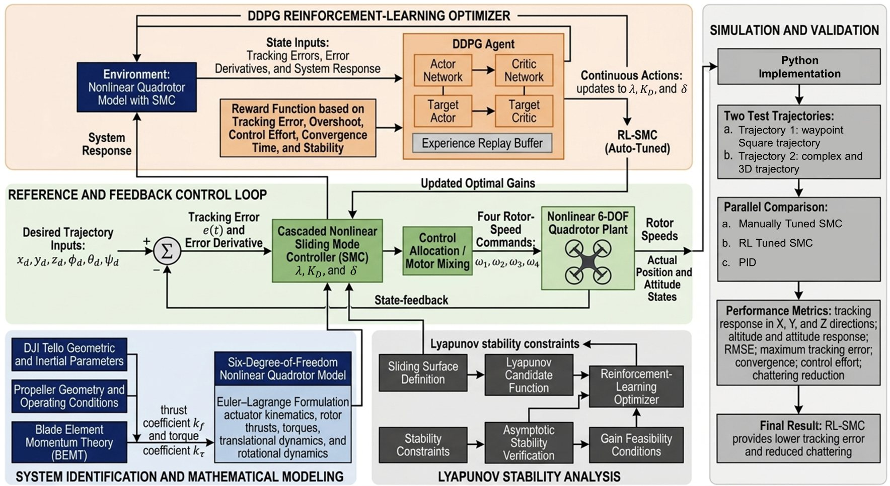
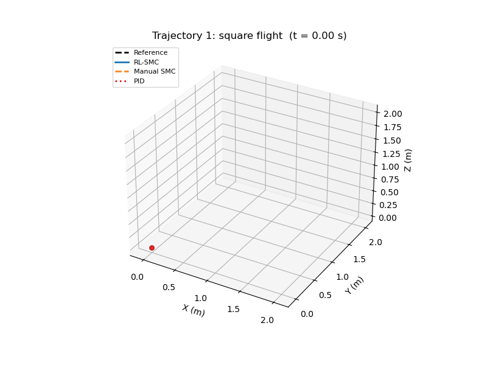
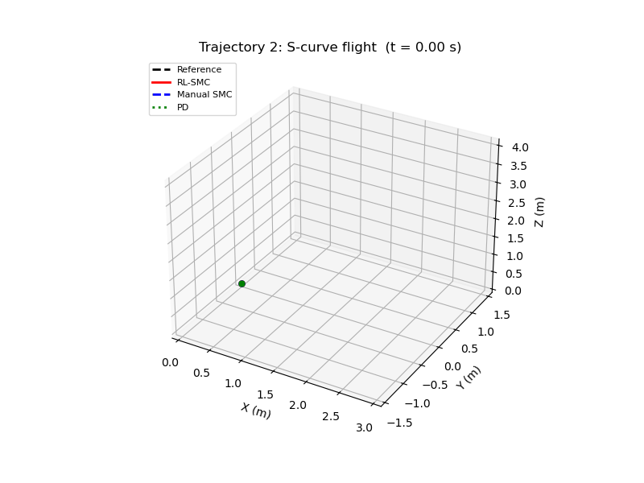

# RL Based SMC Gain Optimization for DJI Tello Quadcopter




The **DDPG-SMC Repository** implements online SMC gain optimization for the DJI Tello quadcopter for trajectory tracking.

️⭐ Reinforcement learning enhanced sliding mode control framework for underactuated quadrotors, with aerodynamic modelling via blade element momentum theory.This repository contains Python simulations of a six-degree-of-freedom quadrotor controlled with sliding-mode control (SMC), offline Deep Deterministic Policy Gradient (DDPG) gain tuning, and an online/time-varying DDPG residual-gain controller ⭐

The offline studies select fixed gains before a trajectory is simulated. The online study changes only the nine position-loop gains during the square manoeuvre; roll, pitch, and yaw gains remain fixed. The plant mass is randomized by 5% during online training, while the controller uses the nominal 0.080 kg model mass.

[](https://pytorch.org/)
[](https://www.python.org/)

This framework includes both offline and online DDPG variants for sliding mode control gain tuning. It generates trajectory visualization GIFs and compares tracking performance against manually tuned SMC and PID/PD baseline controllers.

## File and Folder Map

- DDPD_Traj_1.py
  - Offline DDPG optimization of fixed SMC gains for all six channels on the square trajectory.
- Simulation_Traj_1.py
  - Trajectory 1 comparison: RL-SMC, manually tuned SMC, and tuned PID; prints metrics and displays figures.
- DDPG_Tracj_2.py
  - Offline DDPG optimization of X/Y/Z position gains for the S-curve trajectory; attitude gains remain fixed.
- Simulation_Traj_2.py
  - Trajectory 2 comparison for SMC and PD controllers; prints position metrics and displays plots.
- DDPG_Online_SMC /online_xyz_ddpg.py
  - Trains online residual-gain DDPG with mass randomization and saves the actor and evaluation data.
- DDPG_Online_SMC /simulation.py
  - Loads an actor and produces fixed-versus-adaptive SVG figures without retraining.
- DDPG_Online_SMC /plot_xyz_ddpg_comparison.py
  - Creates PNG tracking, 3-D, and gain-history comparisons from saved NPZ files.
- DDPG_Online_SMC /results_final/
  - Selected validated online result set, including mass sweep and figures

## Trajectory 1 square trajectory
The square experiment uses `Simulation_Traj_1.py` to compare three controllers on the same reference: offline RL-SMC, manually tuned SMC, and tuned PID. The reference contains horizontal directional transitions and altitude segments. The script reports RMSE, IAE, MAE, attitude measures, and peak attitude angles, and displays position tracking, error, attitude, 3-D path, and sliding-surface/phase-plane figures.
The optional preceding optimization is performed by `DDPD_Traj_1.py`. It searches fixed position and attitude SMC parameters and writes a NumPy result file plus a companion gains file. The gains are then copied into the comparison script when a new offline optimization is selected.

<p align="center">

</p>


## Trajectory 2 S-curve trajectory
The S-curve experiment is independent of the square experiment. `DDPD_Traj_2.py` uses a three-dimensional S-shaped reference and optimizes the X/Y/Z position gains. Its attitude gains are fixed. The script displays a top-down XY path, a 3-D path, position-versus-time plots, and per-axis tracking errors. `Simulation_Traj_2.py` provides the corresponding S-curve controller comparison and prints the position RMSE, IAE, MAE, and cost metrics.


<p align="center">

</p>


## Full online DDPG results
The online controller in `online_xyz_ddpg.py` is a different experiment from the offline scripts. The actor receives a normalized 23-element observation and produces nine bounded residuals for `[lambda_x, K_x, delta_x, lambda_y, K_y, delta_y, lambda_z, K_z, delta_z]`. These residuals are smoothed before being applied. Roll, pitch, and yaw gains remain fixed.
Training uses a nominal controller mass of 0.080 kg and samples the simulated plant mass uniformly from 0.076 to 0.084 kg. Training alternates hover and square cases. Adaptation is disabled during hover so the hover baseline remains unchanged; adaptation is active during the square manoeuvre, where horizontal transients provide the learning signal. Therefore, similar hover RMSE values are expected and should not be described as an adaptive improvement.

## Installation and run instructions

Run all commands from the repository root. A Python 3.9+ environment is recommended. Install the packages below:

python -m venv .venv

.\.venv\Scripts\Activate.ps1

python -m pip install --upgrade pip

python -m pip install numpy scipy matplotlib torch numba


**Syntax check without starting training:**

python -m py_compile DDPD_Traj_1.py DDPD_Traj_2.py Simulation_Traj_1.py Simulation_Traj_2.py

python -m py_compile online_xyz_ddpg\online_xyz_ddpg.py online_xyz_ddpg\simulation.py online_xyz_ddpg\plot_xyz_ddpg_comparison.py

**Square optimization smoke test and full run:**

python DDPD_Traj_1.py --passes 1 --episodes 2 --patience 2 --no-plots --output square_smoke.npz

python DDPD_Traj_1.py --passes 3 --episodes 600 --patience 55 --seed 7 --output square_ddpg_results.npz

**Square comparison:**

python Simulation_Traj_1.py

**S-curve optimization and comparison:**

python DDPD_Traj_2.py
python Simulation_Traj_2.py

**Online DDPG smoke test and training:**

python online_xyz_ddpg\online_xyz_ddpg.py --episodes 2 --train-scenario both --output online_xyz_ddpg\smoke
python online_xyz_ddpg\online_xyz_ddpg.py --episodes 60 --train-scenario both --seed 7 --output online_xyz_ddpg\results_new

**Online plots from saved trajectories:**

python online_xyz_ddpg\plot_xyz_ddpg_comparison.py --results online_xyz_ddpg\results_new --output online_xyz_ddpg\results_new\plots

**Evaluation without retraining:**

python online_xyz_ddpg\simulation.py --results online_xyz_ddpg\results_final --output online_xyz_ddpg\results_final\simulation_figures

## Troubleshooting
If an online plotting command reports missing files, verify that the specified result directory contains `online_xyz_ddpg_actor_critic.pt`, both adaptive/fixed NPZ files, and `evaluation_summary.json`. If a training run is slow, start with the smoke command, then increase the episode count. If figures appear in windows rather than being saved, use `simulation.py` or `plot_xyz_ddpg_comparison.py`, which save files directly.

## Funding
This work was supported by the Natural Science Foundation of Top Talent of SZTU (Grant No. GDRC202411) and GuangDong Engineering Technology Research Center of Edge Intelligence.

## Citation
If you use this code in your research, please cite our work:

```bibtex
@Article{electronics15215152,
AUTHOR = {Nashit, Arshad Syed Muhammad and Malik, Kamal Mazhar and Chen, Mingqi and Li, Qiang and Ming, Zhong},
TITLE = {Intelligent Flight Tracking for Uncrewed Aerial Vehicles with Blade Element Momentum Aerodynamic Modeling},
JOURNAL = {Electronics},
VOLUME = {15},
YEAR = {2026},
NUMBER = {21},
ARTICLE-NUMBER = {5152},
URL = {https://www.mdpi.com/2079-9292/15/21/5152},
ISSN = {2079-9292},
ABSTRACT = {Quadrotors attract broad military and civilian interest, yet their underactuated, highly coupled, and nonlinear dynamics make precise control difficult. While sliding-mode control (SMC) offers robust trajectory tracking, tuning its parameters remains a tedious manual task. To address this challenge, this research presents deep deterministic policy gradient (DDPG) with SMC for a DJI Tello quadrotor whose aerodynamic coefficients are estimated using blade element momentum theory. Two controller variants are evaluated separately. The offline variant uses DDPG to select bounded fixed SMC gains for two reference-trajectory comparisons against manually tuned SMC and PID/PD baselines. The online variant uses a residual DDPG actor to update position-loop gains during a separate square-trajectory simulation while the attitude loop gains remain fixed. The fixed-gain comparisons show lower reported position-tracking RMSE for the DDPG-tuned controller under the tested conditions. The online experiment demonstrates bounded gain variation and its effect on square-trajectory tracking under the specified mass-uncertainty protocol.},
DOI = {10.3390/electronics15215152}
}


