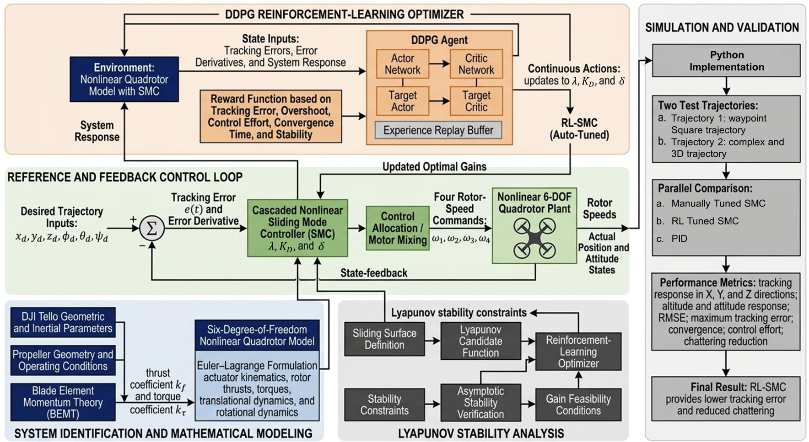

# [Hugo Research Group Theme](https://github.com/wowchemy/starter-hugo-research-group)

The **DDPG-SMC Repository** implements online SMC gain optimization for the DJI Tello quadcopter for trajectory tracking.

️⭐ Reinforcement learning enhanced sliding mode control framework for underactuated quadrotors, with aerodynamic modelling via blade element momentum theory.

This framework includes both offline and online DDPG variants for sliding mode control gain tuning. It generates trajectory visualization GIFs and compares tracking performance against manually tuned SMC and PID/PD baseline controllers.

[Check out the latest demo](https://research-group.netlify.app/) of what you'll get in less than 60 seconds, or [view the showcase](https://hugoblox.com/creators/).

The integrated [**Wowchemy**](https://hugoblox.com) website builder and CMS makes it easy to create a beautiful website for free. Edit your site in the CMS (or your favorite editor), generate it with [Hugo](https://github.com/gohugoio/hugo), and deploy with GitHub or Netlify. Customize anything on your site with widgets, light/dark themes, and language packs.

- 👉 [**Get Started**](https://hugoblox.com/hugo-themes/)
- 📚 [View the **documentation**](https://docs.hugoblox.com/)
- 💬 [Chat with the **Wowchemy research community**](https://discord.gg/z8wNYzb) or [**Hugo community**](https://discourse.gohugo.io)
- ⬇️ **Automatically import citations from BibTeX** with the [Hugo Academic CLI](https://github.com/GetRD/academic-file-converter)
- 🐦 Share your new site with the community: [@wowchemy](https://twitter.com/wowchemy) [@GeorgeCushen](https://twitter.com/GeorgeCushen) [#MadeWithWowchemy](https://twitter.com/search?q=%23MadeWithWowchemy&src=typed_query)
- 🗳 [Take the survey and help us improve #OpenSource](https://forms.gle/NioD9VhUg7PNmdCAA)
- 🚀 [Contribute improvements](https://github.com/HugoBlox/hugo-blox-builder/blob/main/CONTRIBUTING.md) or [suggest improvements](https://github.com/HugoBlox/hugo-blox-builder/issues)
- ⬆️ **Updating?** View the [Update Guide](https://docs.hugoblox.com/hugo-tutorials/update/) and [Release Notes](https://github.com/HugoBlox/hugo-blox-builder/releases)

## We ask you, humbly, to support this open source movement

Today we ask you to defend the open source independence of the Wowchemy website builder and themes 🐧

We're an open source movement that depends on your support to stay online and thriving, but 99.9% of our creators don't give; they simply look the other way.

### [❤️ Click here to become a GitHub Sponsor, unlocking awesome perks such as _exclusive academic templates and widgets_](https://github.com/sponsors/gcushen)

## Demo credits

Please replace the demo images with your own.

- [Female scientist](https://unsplash.com/photos/uVnRa6mOLOM)
- [2 Coders](https://unsplash.com/photos/kwzWjTnDPLk)
- [Cafe](https://unsplash.com/photos/RnDGGnMEOao)
- Blog posts
  - https://unsplash.com/photos/AndE50aaHn4
  - https://unsplash.com/photos/OYzbqk2y26c
- Avatars
  - https://unsplash.com/photos/5yENNRbbat4
  - https://unsplash.com/photos/WNoLnJo7tS8
